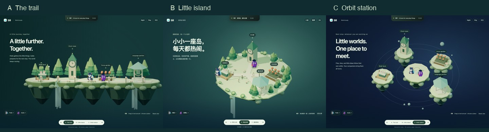

# Sill：从一个角色的旅程，到一座小世界

2026-10-17 · 前一轮游戏化网站概念探索

> 后续已收敛为[无限彩虹赛道](rainbow-race-design-20261017.md)，`prototype-world.html` 现为赛道原型。本文与配套截图保留为设计过程记录，下方三个旧方向的交互入口已被替换。

## 设计命题

把原站看作一款小型游戏：它原先只有“泡泡一路收集东西”的核心循环。现在产品能暂存内容、运行组件、打开工具，也有了核核与茄博士等不同性格的伙伴。设计要更新世界规则、角色分工和行动，而不只是给旧画面换文案、往岛里增加图标。

本轮的可体验草案位于 `prototype-world.html`，使用 `?variant=trail|island|orbit` 切换。默认展示 3D 浮岛，可拖动镜头、进入四处场所、与两位居民互动、暂停、切换昼夜及语言。原首页保持原样；此原型没有加入导航、SEO 或发布流程。

研究问题：**当组件与工具成为世界里的场所，两位角色一起生活在其中，用户能否通过观察和参与看懂 Sill？**

## 1. 从功能名称，到世界中的事情

原来的动词是“遇见 → 收集 → 送到顶部”。新世界增加“停留、照看、专注、交流、整理、出发”。用户可以直接看它运行，也可以插入一个小动作。

| 世界要素 | 角色 / 行动 | 产品含义 | 表达边界 |
| --- | --- | --- | --- |
| 收纳码头 | 核核接住纸片，搬到码头，再送往屏幕顶部 | 内容架、文件与片段的中转 | 文件只使用示例，不读取用户文件 |
| 时光塔 | 钟一直走，昼夜影响光线，居民点起灯 | 时钟的常驻、抬眼可见 | “拨动昼夜”改变这个世界，不暗示修改系统时间 |
| 专注花园 | 茄博士坐下读书；开始计时后番茄慢慢成长 | 番茄钟与专注节奏 | 计时有明确开始与结束；不把游戏奖励说成 App 功能 |
| 翻译风亭 | 一句话穿过风亭，以另一种语言抵达顶部 | 输入、处理、输出的工具操作 | 只有用户触发才翻译；当前使用固定、本地、可见的示例 |
| 记事树 / 留言牌 | 短句化作可带走的纸签 | 快速笔记 | 后续拓展，不在首个草模塞满 |
| 天气观测点 | 风向标、云与窗灯响应天气 | 天气组件 | 正式版若联网需明确城市和来源；草模仅做环境想象 |
| 相片温室 | 熟悉的照片成为岛上的小窗 | 照片组件 | 图片是用户内容，不变成外部相册服务承诺 |
| 书库与路线图 | 茄博士查阅来过的片段、找到应用和目录 | 剪贴板、Apps、Files | 完整工具仍须用真实界面解释，世界是导览与隐喻 |

这张表决定“为什么要动”。动作必须改变一个可读的状态，或建立角色之间的关系。

## 2. 多主角的分工与关系

### 核核 / Pobb：收集与照看

沿用现有角色的耳朵、圆润轮廓、背上的青蓝护鳞。动作以接住、搬运、回头等候、守着东西为主。它关心“你的东西有没有安全到达”。

### 茄博士 / Professor Aubie：理解与准备

沿用紫色茄子轮廓、眼镜、学士帽和书。动作以翻书、思考、指向路标、安静阅读、发现后的短暂庆祝为主。它关心“接下来这件事怎样更顺手”。

### 角色多了，戏也要变

两人不能各自循环同一套 idle。核核送来一张纸签，茄博士看向它；博士进入专注时，核核慢下来守在附近；计时结束，两人一起收下一颗番茄。角色间的观察、等待与交接，比同时弹跳更有生命力。

首轮只用两个已有角色。时钟、天气、照片是场所和道具，不急着都变成新宠物。以后增加角色，先定义一个新的性格与动词，再设计造型，避免只是更多颜色的吉祥物。

现有角色来源：`../sill-app/Sources/SillApp/Resources/IslandPet/{Pobb,ProfessorAubergine}/idle.png`；角色名称与茄博士性格来自当前本地化和 `pet.json`。本轮只复制原画到原型，不修改 App 资源。

## 3. 三个方向

### A. 同行小队：横向旅程

沿着原来的横向路径扩展。核核领路，茄博士跟随或在驿站停留，远近景持续建立前进感。道路经过码头、钟楼、花园和风亭；屏幕顶部始终是共同的家。

- 空间：横向长路径，多层森林，前景偶尔遮住脚部；主角和目的地始终清楚。
- 参与：点路上的物件或驿站，小队短暂停下执行动作，然后继续。
- 多角色：前后队列、回头等待、接力传递；新增主角可以加入旅程。
- 适合：最大程度继承原站的“走着走着就理解了”。
- 需要解决：能力一多，演示周期容易过长。必须能点选目的地，不能要求看完整段才能找到功能。

### B. 浮岛日常：可转动的 3D 微缩世界（优先推进）

将 Sill 想成一座被拿在手里的小岛。四处场所通过小径连接，纸片、书本、植物和灯构成居民的日常。用户拖动镜头，会看到树后的花园、码头下的流水和另一侧的伙伴。

- 空间：略俯视的正交镜头；实体地形、厚度、建筑、阴影、遮挡。中央留下可行走的空间。
- 参与：拖动看另一面；点击场所，角色前往；点击动作，看到结果飞向视口顶部。
- 多角色：同时生活在世界里，各做各的事，必要时交接；不是轮流出现的功能讲解员。
- 适合：让“内容 + 组件 + 工具”自然成为一个可以长大的整体。
- 需要解决：微缩场景容易像普通城建游戏。必须保留“世界里的东西抵达真实页面顶部”的跨空间动作，以及 Sill 角色、海玻璃色和具体内容物。

### C. 星际驿站：围绕同一个家运行

顶部岛是一座太空驿站，内容、时间、专注与语言成为轨道上的小星球。核核负责接驳，茄博士在观测点读懂信号。内容沿着有方向的光带汇入顶部。

- 空间：中心站、不同距离的卫星、小行星和轨道线；镜头可观察各个星球。
- 参与：选择轨道目的地，跟随一次接驳；扩展包可以成为新的可访问世界。
- 多角色：两位伙伴分别在中心站与远端场所工作，通过物件往来建立关系。
- 适合：表达扩展性，容纳后续组件、工具和场景包。
- 需要解决：抽象光带容易压过具体功能，阅读距离也更远。应把“文件是什么、结果在哪里”表现得比轨道特效更清楚。

三种方向复用角色与产品事实，但讨论的是不同的空间和游玩方式：顺着道路前进、在岛上自由探索、在轨道之间跳转。不是三种配色。

## 4. 3D 版的镜头与美术

优先采用**真实 3D 环境 + 原画纸片角色**的第一阶段方案。地形与道具拥有体积、遮挡、光照；角色面向镜头，保留已建立的品牌样貌。类似可转动的立体绘本，适合验证世界，而不必先耗费大量成本绑定和重做角色动画。

| 维度 | 设计选择 |
| --- | --- |
| 镜头 | 默认俯角约 39°，正交投影，有限自由旋转；没有自动绕场飞行与突然拉近 |
| 形体 | 温和的低多边形土层、圆润植被、清楚的建筑剪影；避免大面积玻璃球和金属科幻面板 |
| 材料 | 哑光土地、木头、纸张，配少量有透感的水与护鳞 |
| 颜色 | 深青绿 `#173b3b`、苔绿 `#839c70`、纸色 `#e1d7ad`、水色 `#94d8c8`、番茄色 `#d27b57`、夜空 `#111e39` |
| 光 | 暖主光与冷补光、柔和接触阴影；入夜后窗口和灯成为较亮的小点 |
| 字 | 沿用系统字体。世界本体占据画面；场所名是小路标，文案是简短旁白 |
| 顶部 | 保留一个真正贴近屏幕顶部的接收目的地；世界中的物件投影到屏幕后继续飞入它 |

若推进全 3D 角色，下一步先各做正面、侧面、背面和三分之四角度的造型校准，再绑定走、接住、交接、读书、睡眠、庆祝六类动作。核核的护鳞、耳朵和尾部以及博士的眼镜、帽子和书必须在小尺寸也能区分。不把程序拼出的通用小动物当作已定稿角色。

## 5. 动态节奏

开场应直接生活着。用户不操作，也能看到伙伴走向自己的场所、钟在走、文件被寄走；用户开始探索后，画面立即让出主动权。

- 环境层：水流、少量萤光、树后景深；运动幅度小，不能所有东西等频率摇晃。
- 角色层：有目的地的移动，以及到达后的等待、观察和短反应。
- 事件层：内容出发、交接、抵达；计时开始与结束；一句话产生译文。一次突出一个事件。
- 视口层：顶部岛的接收反馈，与场景中的来源保持明确关联。
- 阅读层：旁白和路标保持稳定，用户打开的内容不被自动切走。

声音是后续可选项：纸张、木桥脚步、轻钟声和环境底声，由用户主动开启。首轮保持静音。

## 6. 文档也是世界的一部分

独立功能指南仍然需要，但可以用“岛上手册”的入口组织：每个场所旁有一个可直接进入的条目，完整目录也能从固定导航打开。角色档案、组件说明、工具说明可以共享插图语言。

指南正文保持普通可搜索、可复制、可链接的 HTML，不要求在 3D 世界里寻路才能读到。场景负责产生兴趣和建立理解，手册负责准确解释权限、Free / Pro、设置和限制。

## 7. 当前草模与后续工作

已做：三个构图、真实 WebGL 地形与道具、两个原画角色、视角拖动、场所选择、示例文件抵达顶部、昼夜、专注计时、本地翻译示例、暂停、语言切换和减少动态效果。

尚属草模：角色使用 poster 加位移动作，没有已绑定的 3D 角色；植物成长使用简单形变；建筑、流水、灯光和事件编排用于检验方向，不是最终美术资产。没有真实天气、文件读取、翻译请求或购买操作。

原型将 Three.js 0.169.0 与 MIT 许可证放在自己的资源目录，浏览器运行时不请求外部 CDN。它不改变当前首页的运行依赖。

下一步先选空间方向，再制作一段 15–25 秒的具体角色故事板和完整事件循环；之后才进入最终场景美术、角色动作与产品页面整合。技术检查不替代这个方向选择。

## 8. 打开与操作

在 `sill-web` 运行 `python3 server.py`，打开：

- `http://127.0.0.1:8000/prototype-world.html?variant=island`：3D 浮岛。
- 同一路径的 `?variant=trail` 与 `?variant=orbit`：横向旅程与星际驿站。
- 底部切换方向，键盘左右键也可切换；点击场所路标或角色头像查看互动。
- 拖动空白处旋转镜头；“回到全景”恢复镜头；右上角切换昼夜、暂停和语言。

不需要 npm 安装、密钥或外部服务。这个原型应留在探索分支，不直接提升为生产首页。

## 9. 本轮自查

已在 Chrome 中查看三个方向的 `1440 × 1000` 桌面和 `390 × 844` 手机画面，并实际操作自然文件寄送、手动寄送、本地译文、计时、昼夜、视角、语言与减少动态效果。暂停后的连续画面保持一致，减少动态效果时仍可手动取得示例结果；观察期间无 JavaScript 异常或横向溢出。修正了手机路标侵入旁白和标题换行的问题，以及切换暂停 / 语言时顶部接收状态被覆盖的问题。

设计判断：优先推进 B，吸收 A 的接力和行走感。C 留作未来扩展包世界或星空主题的方向。B 的风险是过于像通用城建游戏，下一轮最应该制作的是“核核和茄博士的一次内容交接”，把这座世界与 Sill 的实际用途连接起来。

实现判断：这是一份方向草模。全 3D 角色、精细步态、路径避障、移动端 GPU 能耗和 Safari 真机表现尚未验证，不能以当前浏览器检查代替生产验收。

## 10. 草模画面与操作记录

- [浮岛桌面画面](design-previews/world-20261017/island-1440.png)
- [浮岛手机画面](design-previews/world-20261017/island-390.png)
- [本轮浏览器操作记录](design-previews/world-20261017/interaction-results.json)

截图用于比较构图；角色移动、内容寄送与镜头空间感请在动态原型中体验。
